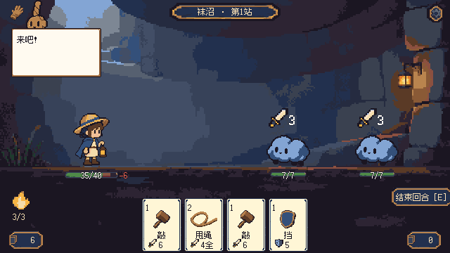
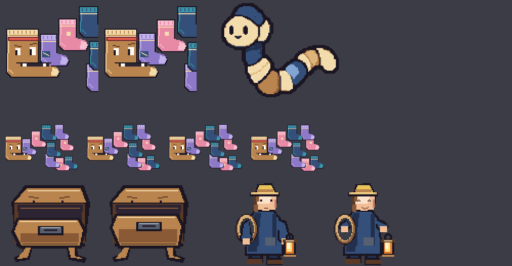
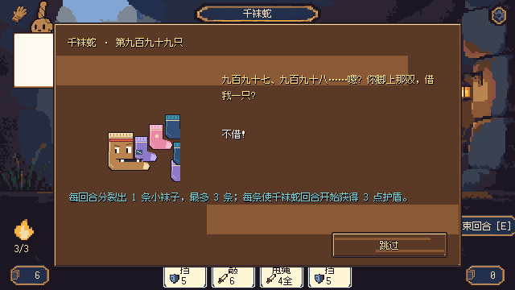
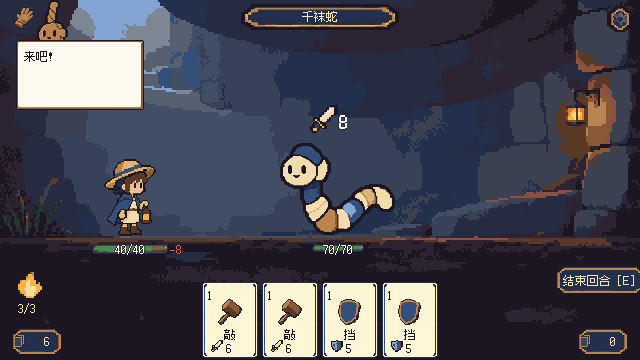
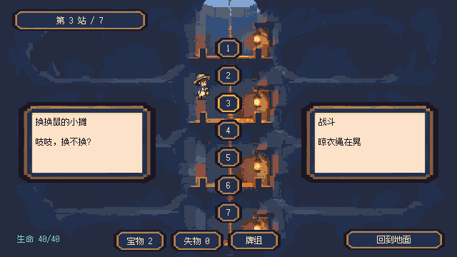
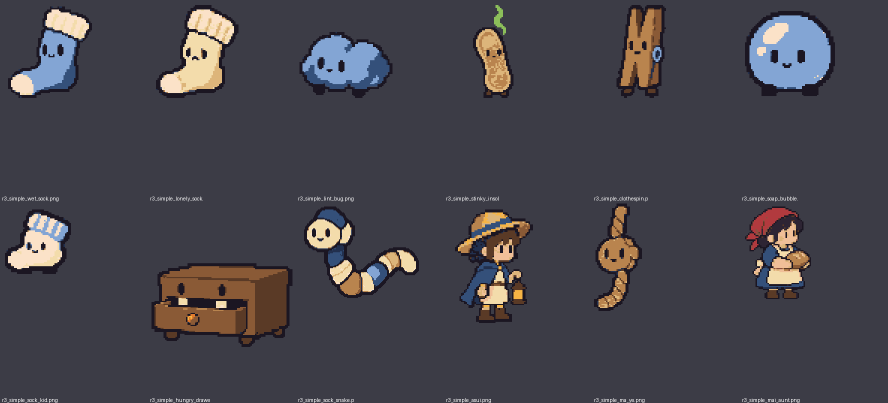

# 《拾遗井》玩法与美术审核 · 整改方案

- 日期：2026-10-27
- 审核对象：`main` @ `335fcca`（final352 干净工程）
- 审核范围：**玩法（主）**、美术与界面（次）。**剧情与背景故事不在本次范围**，所有剧情文案、故事页、人物设定保持不动。
- 本文用途：交给执行方（GPT / Codex）按本文逐阶段整改。审核方只看不改，本文之外没有改动任何游戏代码、数据或素材。

---

## 0 给执行方的说明（先读这一节）

1. **默认执行「方案 A：绳与对」**（第 3 节）。只有用户明确说「只做保守版」时，才改为只执行「方案 B：去指纹」（第 4 节）。第 9 节列出了需要用户拍板的事项；用户没回答的，按「默认值」执行。
2. **不改剧情**：`data/story/*.json`、`story.*` 文本、归还故事、人物台词的含义都不动。如果新玩法需要新的玩家提示语（例如教学语、规则说明），只加 `ui.*` 文本，不改故事。
3. **保持现有工程原则**：规则引擎是纯函数、确定性、数据驱动（`scripts/core/*` + `data/*.json`）；所有数值写在 JSON 里；表现层只播放规则事件。新机制也必须这样做。
4. **先恢复测试，再改规则**：干净工程里没有测试。先从 Git 历史 `b1eb91e` 恢复 `godot/tests/battle/*`、`godot/tests/expedition/*`、`godot/tests/sim_runner.gd`、`godot/tests/test_runner.gd`，按新目录（根目录 `project.godot`）调好路径，确认在旧规则上全部通过，再开始改。临时测试脚本也可参考本机 `.local/bundle-import/2026-10-26/tests/`。
5. **按第 7 节的阶段顺序做**，每个阶段都有验收标准。每阶段结束跑：规则测试 + 300 趟模拟 + 实际窗口截图。
6. 存档：新规则会改变战斗状态结构，必须提升存档版本并写迁移（见 7.1）。
7. 不要引入：传送带式手牌/牌的位置决定效果（与 MECHBORN 撞车）、翻牌记忆配对（与 Replicat 撞车）、把敌人收进牌组（与 Decktamer 撞车）。详见 2.3。
8. **美术素材的生产方式是「本地统筹，云端 Dot 生成，本地下载验收」**，规则见 5.4。本地不调用任何图片生成 API。
9. **无人值守执行时**（用户不在场）：不等待确认，第 9 节按默认值推进；遇到需要人工的事项（登录、验证码、付费、关键缺失信息），写进进度记录，跳过这一项，继续做其他不受影响的工作。

---

## 1 结论摘要

| 维度 | 结论 |
|---|---|
| 上手难度 | 好。规则少、敌人意图公开、"将受到 X"预报、战败重试变弱，新手很友好。**这部分要保留。** |
| 与市面游戏的重合 | **高风险，集中在战斗核心。** 战斗的回合循环、起始牌数值、意图表现、战斗布局、大部分卡牌和奇物效果、路线节点，几乎都能在《杀戮尖塔》里找到一一对应。《杀戮尖塔 2》已于 2026-03-05 开启抢先体验，玩家对这套表达的辨识度正处在最高点。 |
| 独特的部分 | 信物借用-归还、心愿、会说话的麻绳旁白、战败变弱重试、牌组上限 12 张替换、没有货币的交换摊。**可惜它们都在战斗外面，打牌的那几分钟里玩家感受不到。** |
| 玩法深度 | **偏浅。** 模拟显示普通战平均 1.3–2.5 回合就结束、掉 0–2.4 血；精英和首领胜率 100%；15 件奇物有没有，对首领胜率的影响都是 0。拿什么奖励都差不多，选择没有分量。 |
| 节奏 | 公式估算一趟约 4 分钟（230–260 秒，不含读剧情和界面操作），远低于设计目标 15–20 分钟。 |
| 美术 | 整体统一、可爱、可读，卡面插图完整。问题在于**新旧两代素材混用**（剧情大头像仍是旧版，和战斗立绘不是同一个造型）、首领缺少压迫感和辨识度、首领登场面板有显示错误、路线画面信息几乎全靠文字。 |
| 建议 | 战斗核心换成主题专属的动词「**缠 / 系 / 凑对**」（方案 A），让"守绳人"和"袜沼凑对"变成手上的操作，而不只是包装。上手难度不升，思考空间变大，与竞品拉开距离。 |

---

## 2 现状审核：玩法

### 2.1 现在的战斗与流程（实际实现）

- 一回合：能量 3，摸 4 张，出牌，回合结束弃掉全部手牌；护盾在你的回合开始时清零。
- 起始牌组 10 张：敲（1 费，6 伤）×4、挡（1 费，5 护盾）×4、甩绳（2 费，全体 4 伤）×1、拽一把（1 费，摸 2）×1。
- 敌人头顶显示意图：剑形图标 + 数字。
- 普通战奖励：2 件奇物 + 1 张牌，三选一；精英：3 件奇物三选一。
- 路线 7 段，每段二选一：普通战 / 事件 / 交换摊 / 精英 / 篝火（回复 12 或最大生命 +4）/ 首领。
- 战斗画面：主角在左、敌人在右；左下能量和抽牌堆，右下弃牌堆，右侧结束回合，底部一排手牌。



### 2.2 与《杀戮尖塔》（StS）的逐项对照

> 说明：单个机制属于业内通用做法，本身不是问题；问题在于**下面这些同时出现、而且很多连数值都一样**。玩家和评测会把它直接归为"换皮尖塔"。

| 本项目 | StS 对应 | 相似程度 |
|---|---|---|
| 起始「敲」6 伤 ×4、「挡」5 护盾 ×4 | Strike 6 伤、Defend 5 格挡，各 4–5 张 | **数值完全一致**，最显眼的指纹 |
| 能量 3、出牌耗能、回合末弃光手牌、护盾在你回合开始清零 | 完全相同的回合循环 | 核心循环一致 |
| 敌人头顶"剑 + 数字"意图 | 同样的意图表现 | 表现一致 |
| 战斗布局：左下能量球和抽牌堆、右下弃牌堆、右侧结束回合、主角左敌人右 | 同样布局 | 界面一致 |
| 拧干：造成等于护盾的伤害 | Body Slam | 效果相同 |
| 拾起：从弃牌堆拿 1 张回手 | Hologram | 效果近乎相同 |
| 深呼吸：下回合多 2 能量（1 费） | Outmaneuver | 效果相同 |
| 顶回去：获得护盾，被攻击时反击 | Flame Barrier | 同一设计 |
| 誓约：之后获得的护盾翻倍 | Entrench（护盾翻倍） | 近似 |
| 连敲 3×2 / 拽过来 5 伤摸 1 / 甩绳 全体伤害 | Twin Strike / Pommel Strike / Cleave | 同一设计 |
| 半块饼干：战斗胜利后回 4 血 | Burning Blood（战后回 6） | 同一设计 |
| 漏气的气球：护盾不清零，改为减半 | Calipers（只失去 15 格挡） | 同一设计 |
| 歪掉的指南针：首回合多抽 3 张 | Bag of Preparation | 同一设计 |
| 落单的纽扣：每打败一个敌人 +1 能量 | Gremlin Horn | 同一设计 |
| 缺了一只的手套：每回合第一张攻击打两次 | Necronomicon | 近似 |
| 褪色的书签：回合末保留 1 张手牌 | Well-Laid Plans | 效果相同 |
| 打结的耳机：每回合第 3 张牌时抽牌 | Kunai / Ornamental Fan 计数类 | 同一类 |
| 备用绳：致死时保留生命 | Lizard Tail | 近似 |
| 事件「帮婆婆收衣服」：下一场开场 8 护盾 | Anchor（开场 10 格挡） | 近似 |
| 篝火：回复 12/40 = 30% | 休息点回复 30% | 比例相同 |
| 路线节点：普通 / 精英 / 篝火 / 事件 / 商店（交换）/ 首领 | 地图节点 | 结构相同 |

其他参照（风险较低，可保留）：首领规则牌、登场台词、旁白人物参照了《炉石传说》冒险模式；"替镇民找回失物"的题材已因 Lost and Found Co. 改名（见设计稿 `c77e402:docs/00-vision.md`）。

### 2.3 新方向要避开的近期竞品（审核时检索确认）

| 游戏 | 它的核心 | 对我们的约束 |
|---|---|---|
| MECHBORN（计划 2027 Q1） | 手牌换成 7 格传送带，牌的效果取决于所在格位 | **不要**做"牌在绳上移动、位置决定效果"。晾衣绳只做外观，不做规则 |
| Replicat（2025-11） | 记忆翻牌配对 + 卡组构筑 | **不要**做翻牌记忆配对 |
| Decktamer（2025-10） | 把敌人驯服收进卡组 | **不要**把凑对送走的敌人变成自己的牌 |

### 2.4 法律与市场风险（不构成法律意见）

- **国内判例有两种走向**：
  - 《太极熊猫》诉《花千骨》（江苏高院〔2018〕苏民终 1054 号，维持 3000 万元判赔）：法院认为玩法规则的"特定呈现方式"及其选择、安排、组合可以受保护。被告抗辩"美术、音乐、故事都不同"，没有被采纳。
  - 《率土之滨》案（广州知识产权法院〔2023〕粤 73 民终 1238 号，2025-08-08 发回重审）：认为以规则和玩法为内容的游戏本质上属于思想、系统、操作方法，不属于著作权法意义上的表达。另有案件走反不正当竞争路径。
- **对本项目的含义**：只"借用 Deckbuilder 这个类型"一般没事；风险来自**同一套规则组合 + 相同数值 + 相同界面布局**叠在一起。2.2 表里正是这类叠加。
- **市场风险更直接**：商店页、试玩视频的第一眼就是战斗画面。被贴上"尖塔换皮"的标签，会直接伤害愿望单和口碑。
- 上线前，建议把新版本截图和数值表交给游戏知识产权律师做一次比对。

### 2.5 玩法深度问题（来自上次交付的模拟日志）

数据来源：`.local/bundle-import/2026-10-26/rules.log`（300 趟、1101 场战斗，防守型策略机器人）。

| 指标 | 数值 | 问题 |
|---|---|---|
| 普通战平均回合数 | 1.36–2.55 | 打两下就结束，来不及形成决策 |
| 普通战平均掉血 | 0–2.44 | 没有压力，"守护"牌几乎不用想 |
| 精英：胜率 / 平均掉血 | 100% / 2.5 | 精英不"精" |
| 首领：胜率 / 平均回合 / 平均掉血 | 100% / 10.2 / 8.5 | 带着奇物稳赢 |
| 15 件奇物对首领胜率的影响 | 全部为 0 | 奖励选择没有意义 |
| 只用起始牌、满血单挑首领 | 防守型 62%，随机出牌 0% | 难度全压在首领一场，曲线前平后陡 |
| 一趟估时 | 230–260 秒 | 目标是 15–20 分钟 |

其他结构问题：

1. **每回合几乎没有选择**：4 张手牌全是 1 费，能量 3，结果就是"打 3 张，敌人打得重就多出挡"。
2. **奖励以奇物为主**（普通战 3 个选项里 2 个是奇物），一趟能拿 4–6 件，每件影响都很小，最后只剩噪音。
3. **信物本质上是被动奇物**（婚戒每回合 +3 护盾等），战斗中没有"借用"的手感；心愿只是"走某条路"的勾选项。
4. **路线二选一的信息全部摊开**（直接写敌人名字和血量），设计稿里"翻路牌"的悬念没了。而且什么都很简单，选哪边差别不大。

### 2.6 要保留的优点

- 确定性规则引擎、数据驱动、预览与"将受到 X"预报（`battle_rules.gd` 的 `preview` / `forecast`）。
- 战败重试：敌人变弱、生命补到一半（独有，友好）。
- 信物借用 → 归还 → 复刻牌入池的元循环；心愿 ♥ 和 ✦ 标记。
- 牌组上限 12 张、满了就替换（不做删牌，和尖塔不同）。
- 交换摊没有货币。
- 侧视单屏舞台、麻爷挂在牌桌上方。

---

## 3 方案 A（推荐）：「绳与对」

### 3.1 设计目标

一句话卖点：**"用一根绳子打架：缠住要打你的，系住同类的，凑成一对就送它们回家。"**

- 把主题（守绳人、麻绳、袜沼里落单的袜子、物归原主）变成战斗里的三个动词：**缠、系、凑对**。
- 难度不升：防守更宽容（缠绳不会在回合末浪费），失败照旧温和。
- 思考空间变大：读意图决定缠谁，决定系哪两只，决定先压低谁的血量才能凑对。
- 奖励和打法挂钩：靠"打散"拿牌，靠"凑对"拿奇物。高手有追求，新手也能过。
- 与 StS 拉开距离：没有全局护盾，手牌不弃光，没有"攻击牌拖敌人、技能牌拖场地"的二分，界面布局全换。

### 3.2 玩家术语（最多 5 个，取代原来的"能量 / 守护 / 意图 / 奇物 / 信物"）

| 术语 | 含义 |
|---|---|
| 力气 | 每回合 3 点，出牌消耗，用不完作废。（取代"能量"，图标换成提灯火苗） |
| 缠 | 给一个敌人绕上几圈绳。它攻击你时，每圈挡 1 点伤害，挡掉多少就用掉多少，**没用完的会留到下回合**。 |
| 系 · 凑对 | 用绳把两个敌人系在一起。同类的两个都"蔫了"（生命 ≤ 一半）时，会**凑成一对，一起回家**（算作战胜它们）。 |
| 信物 | 委托人的东西，这一趟借你用：**每场战斗可以用一次它的本事**，用完回去照样归还。 |
| 拾物 | 一路捡到的小东西，拿到就生效，改写一条规则。（取代"宝物/奇物"；最终用词见第 9 节） |

"意图"不再算术语，界面直接画成敌人头上的动作气泡。

### 3.3 战斗规则（完整）

#### 回合流程

```text
战斗开始：洗牌 → 「战斗开始」效果 → 补牌到 5 → 敌人公开意图
┌ 你的回合
│ 1 力气回满 3（+ 上回合的「下回合」效果）
│ 2 「回合开始」效果
│ 3 补牌：手牌补到 5 张（不是"抽 N 张"）；手牌上限 7
│ 4 出牌，顺序随意；每回合可以免费「抖一张」1 次：弃 1 张手牌、摸 1 张
│ 5 点「收手」（结束回合）→ 「回合结束」效果。**不弃手牌**
├ 敌人回合
│ 6 清掉所有敌人的「裹紧」（敌方护甲，名字改了，规则同现在的敌人护盾）→ 敌人「回合开始」效果
│ 7 敌人从左到右执行意图；攻击先被身上的「缠」抵消
│ 8 敌人「回合结束」效果（如首领分裂）
│ 9 凑对检查
│ 10 敌人公开下一个意图
└ 回到 1
```

- 玩家**没有护盾**。原"守护/护盾"系统从玩家侧移除（引擎里敌人的护甲保留，改名"裹紧"）。
- 胜利：所有敌人被"打散"（生命为 0）或"凑对回家"。
- 战败、重试、备用绳的流程保持不变（备用绳效果见 3.6）。

#### 缠（bind）

- 每个敌人有 `binds`（缠绳圈数），上限 12。
- 敌人执行攻击时，**每一段**伤害先扣它身上的缠：挡掉多少就消耗多少圈，剩下的圈数保留。例：缠 4、攻击 3×2 → 第一段全挡（剩 1 圈），第二段受 2。
- 敌人不攻击的回合（裹紧、召唤、发呆等），缠绳原样保留。
- 有些敌人的动作会**挣脱**：移除自己身上全部或一半的缠（写在意图里，玩家能提前看到）。
- 意图气泡实时显示扣除后的数字，例如"扑 5 → 1"。"将受到 X"继续常驻在阿穗旁边。

#### 系（tie）与凑对（pair）

- 「系」需要选**两个不同的、还活着的敌人**。每个敌人最多和一个伙伴系在一起，再系会替换旧的那根绳。
- **连带**：被系着的敌人因为你的牌失去生命时，它的伙伴失去其中一半（向下取整）。连带伤害不会再连带。
- **凑对**：每个敌人有对类标签 `pair_tag`（袜 / 毛 / 夹 / 泡；没有标签的永远不能凑对）和凑对门槛 `pair_threshold`（默认 0.5）。被系在一起的两个敌人对类相同，且**两个都"蔫了"**（生命 ≤ ⌈最大生命 × 门槛⌉）时，立刻凑成一对、一起离开。
- 凑对检查的时机：每张牌结算完后、敌人回合结束时。
- 凑对离开的敌人算"已战胜"，不再行动；触发 `pair_formed` 钩子；记入本场 `battle_flags.pairs`。
- 只有一个敌人时，「系」类牌改为执行它的备用效果（每张牌都要写备用效果）。

#### 奖励和打法挂钩

| 战斗 | 结算 |
|---|---|
| 普通战 | 牌三选一，可跳过。**本场有过凑对**时，再给一份「谢礼」：拾物二选一（每场最多一份） |
| 精英 | 拾物三选一；✦ 信物另给 |
| 首领 | 无三选一。和平结局（见 3.8）只多一行提示，不改剧情 |

效果：拾物数量从"一趟 4–6 件、件件无感"降到"2–4 件、靠凑对赚来"，每件都更有分量。

### 3.4 卡牌

卡牌类型从「攻击 / 守护 / 特殊」改为「**打 / 绳 / 杂**」，数据字段 `type`：`attack` / `rope` / `special`。所有数值是初稿，按第 6 节的模拟目标调参。尽量沿用现有 id 和卡面插图（插图内容与新效果对得上的才沿用），需要新图的已标出。

#### 起始牌组（10 张）

| id | 名字 | 类型 | 力气 | 目标 | 效果 | 数量 |
|---|---|---|---|---|---|---|
| card.knock | 敲 | 打 | 1 | 一个敌人 | 造成 5 点伤害 | 3 |
| card.bind（新，需新图） | 缠 | 绳 | 1 | 一个敌人 | 缠 4 | 3 |
| card.tie（新，需新图） | 系 | 绳 | 1 | 两个敌人 | 把两个敌人系在一起。只有一个敌人时：缠它 2 | 2 |
| card.rope_lasso | 甩绳 | 绳 | 2 | 全体 | 所有敌人缠 3 | 1 |
| card.tug | 拽一把 | 打 | 1 | 一个敌人 | 造成 3 点伤害，摸 1 张 | 1 |

`card.brace`（挡）退出起始牌组。

#### 奖励池（16 张）

| id | 名字 | 类型 | 力 | 效果 | 新 op 提示 |
|---|---|---|---|---|---|
| card.double_tap | 连敲 | 打 | 1 | 造成 3 点伤害 2 次；目标身上有缠时再打 1 次 | `damage` + `bonus_hit_if_bound` |
| card.big_hammer | 重锤 | 打 | 2 | 造成 13 点伤害；目标被系着时，伙伴受全额连带（而不是一半） | `damage` + `link_full` |
| card.dust_off | 掸灰 | 打 | 0 | 造成 2 点伤害；目标已经蔫了时改为 4 点 | `damage_if_wilted` |
| card.wring | 拧干 | 打 | 1 | 解开目标身上全部的缠，每圈造成 2 点伤害 | `unbind_damage` |
| card.yank | 拽过来 | 打 | 1 | 造成 4 点伤害；目标被系着时，它和伙伴交换下一个意图 | `swap_intent_with_partner` |
| card.curl_up | 绕两圈 | 绳 | 1 | 缠 7 | `bind` |
| card.clothesline | 晾衣绳 | 绳 | 2 | 所有敌人缠 4，并把最左边两个还没被系的敌人系在一起 | `bind_all` + `tie_leftmost` |
| card.push_back | 顶回去 | 绳 | 1 | 缠 3；它下次攻击被完全挡住时，它自己受到 4 点伤害 | `bind` + `recoil_if_fully_bound` |
| card.blanket | 披毯子 | 绳 | 0 | 缠 2 | `bind` |
| card.knot | 打个结 | 绳 | 1 | 目标身上缠 ≥ 3 时，它下一个意图改为「发呆」；否则缠 3 | `idle_if_binds` |
| card.shake_rope | 晃绳子 | 绳 | 1 | 把一个敌人身上的缠全部挪到另一个敌人身上，再 +2 | `move_binds`（两个目标） |
| card.pocket | 翻口袋 | 杂 | 0 | 摸 1 张；本回合「抖一张」次数 +1 | `draw` + `extra_shake` |
| card.deep_breath | 深呼吸 | 杂 | 1 | 下回合手牌补到 7 张（不是 5） | `next_turn_refill` |
| card.pick_up | 拾起 | 杂 | 1 | 本场每凑成过一对，摸 1 张并回 1 力气；还没凑过对时摸 1 张 | `per_pair_draw_energy` |
| card.double_knot（新，需新图） | 双头结 | 绳 | 1 | 把两个敌人系在一起，并各缠 2。只有一个敌人时：缠它 4 | `tie` + `bind_both` |
| card.one_pair（新，需新图） | 凑一对 | 绳 | 1 | 本回合被系着的同类敌人凑对门槛改为 75%；没有这样的组合时：所有敌人缠 2 | `pair_threshold_override` |

已移除的设计思路：Body Slam / Hologram / Outmaneuver / Flame Barrier / Entrench / Twin Strike / Pommel Strike 的原样效果。新增牌时请对照 2.2 表自查，不要再加回来。

#### 复刻牌（信物归还后入池）

| id | 名字 | 类型 | 力 | 效果 | ＋版 |
|---|---|---|---|---|---|
| card.vow | 誓约 | 杂 | 1 | 本回合你施加的缠全部翻倍 | 0 力 |
| card.whisper | 悄悄话 | 绳 | 0 | 缠 3，并在本场看见该敌人之后 2 个意图 | 再多缠 2 |
| card.deliver | 投递 | 杂 | 1 | 免费打出手里另一张牌；如果那张是「系」类，系完立刻按 75% 门槛做一次凑对检查 | 0 力 |

### 3.5 拾物（原 15 件奇物：id、名字、插图、来历文字全部保留，只改效果）

| id | 名字 | 新效果 |
|---|---|---|
| relic.lone_glove | 缺了一只的手套 | 每场第一次凑对时，摸 2 张、回 1 力气 |
| relic.spyglass | 船长的望远镜 | 不变：敌人意图多显示 1 回合 |
| relic.lost_kite | 迷路的风筝 | 每次系成功，两头各受 2 点伤害 |
| relic.open_ink | 没盖的墨水瓶 | 手牌补到 6 张（原来 5） |
| relic.half_biscuit | 半块饼干 | 每凑成一对，回复 3 点生命 |
| relic.offkey_harmonica | 走调的口琴 | 回合结束时，每剩 1 点力气，给对你威胁最大的敌人缠 2 |
| relic.empty_frame | 空相框 | 每场开始，最左边的敌人第一回合「发呆」 |
| relic.leaky_balloon | 漏气的气球 | 敌人挣脱时，只能挣掉一半的缠（向下取整） |
| relic.crooked_compass | 歪掉的指南针 | 战斗开始时，如果有两个同类敌人，自动把它们系在一起 |
| relic.bookmark | 褪色的书签 | 每回合第一次「抖一张」后，多摸 1 张 |
| relic.shedding_brush | 掉毛的毛刷 | 打身上有缠的敌人时，伤害 +2 |
| relic.tangled_earbuds | 打结的耳机 | 每回合第一张「系」类牌不花力气 |
| relic.flat_ball | 瘪掉的足球 | 被系着的两个敌人里，一个被打散时，另一个受到 6 点伤害 |
| relic.birthday_candle | 生日蜡烛 | 谢礼多 1 个选项（2 选 1 → 3 选 1） |
| relic.odd_button | 落单的纽扣 | 场上只剩 1 个敌人时，「打」类牌伤害 +2 |

实现提示：现在 `hooks.gd` 里为 `lone_glove`、`birthday_candle`、`empty_frame`，`battle_rules.gd` 里为 `leaky_balloon`、`open_ink`、`crooked_compass`、`shedding_brush` 写了专用分支。改为新效果时，尽量换成通用的 `trigger` + `when` + `ops`，减少硬编码。新增触发点：`tie_made`、`pair_formed`、`bind_applied`、`enemy_shake_off`、`shake_card`。

### 3.6 信物：从"被动奇物"改成"每场一次的本事"

- 规则：每件信物在战斗里有一个**主动按钮**（主人小头像），每场限用 1 次，0 力气。按下时播放这件信物已有的台词（只复用现有台词，不新写剧情）。
- 借用 → 归还、心愿、复刻牌规则全部不变。

| id | 主动本事（新） | 说明 |
|---|---|---|
| keepsake.ring（婚戒） | 所有敌人缠 3 | 原"每回合 +3 护盾"的替代 |
| keepsake.mianmian（棉棉） | 指定一个敌人：它本回合的攻击改为「发呆」 | 对应"棉棉提前喊出来" |
| keepsake.letter（旧信） | 把任意两个敌人系在一起（这次不要求同类）并各缠 2；如果两个都蔫了，立刻凑对 | "投递到收件人身边" |

- 心愿条件保持现状（篝火休息、孤袜长椅、回声邮筒），不动剧情。（可选扩展见第 9 节）
- 守绳屋服务「备用绳」改为：每趟一次，生命降到 0 时保留 1 点，并给所有敌人缠 5（麻爷："抓紧了！"台词沿用）。

### 3.7 敌人与遭遇

生命数值是建议值：因为缠的防守更宽容、凑对能提前结束战斗，敌人生命整体上调约 30%，最终以模拟为准。

| id | 名字 | 生命（旧→建议） | 对类 | 意图循环（新） |
|---|---|---|---|---|
| enemy.wet_sock | 湿袜子 | 12 → 16 | 袜 | 扑 5 → 扑 5 → 拧干自己（挣脱全部缠，裹紧 4） |
| enemy.lonely_sock | 孤袜 | 18 → 22 | 袜 | 扑 7 → 叹气（裹紧 6）。特性：和另一只袜子系在一起时，攻击 -2 |
| enemy.lint_bug | 毛球虫 | 7 → 9 | 毛 | 滚 3 → 滚 3 → 滚成团（挣脱一半缠，裹紧 4） |
| enemy.stinky_insole | 臭鞋垫 | 20 → 26 | 无 | 熏 4（你下回合少补 1 张）→ 拍 8 |
| enemy.clothespin | 晾衣夹 | 10 → 13 | 夹 | 夹 4 → 夹 4 → 夹紧 8（无视 2 圈缠） |
| enemy.soap_bubble | 肥皂泡 | 6 → 8 | 泡 | 泡泡罩（所有敌人裹紧 3）→ 碰 2 |
| enemy.sock_kid | 小袜子 | 4 | 袜，门槛 100%（随时能凑） | 扑 3 |

遭遇组（约 2/3 的普通战有凑对机会）：

| id | 组成 | 凑对机会 |
|---|---|---|
| enc.tutorial | 湿袜子（教学） | 无 |
| enc.t1_a | 湿袜子 | 无 |
| enc.t1_b | 毛球虫 ×2 | 有（**凑对教学战**） |
| enc.t2_a | 孤袜 + 湿袜子 | 有（袜） |
| enc.t2_b | 湿袜子 + 肥皂泡 | 无 |
| enc.t2_c | 晾衣夹 ×2 | 有（夹） |
| enc.t2_d | 毛球虫 ×3 | 一对 + 一只落单 |
| enc.t3_a | 臭鞋垫 + 毛球虫 ×2 | 一对 + 硬骨头 |
| enc.t3_b | 孤袜 + 肥皂泡 ×2 | 一对（泡）+ 孤袜 |
| enc.t3_c | 晾衣夹 + 湿袜子 + 肥皂泡 | 无，纯打 |

### 3.8 精英与首领

**精英 · 饿抽屉**（生命 40 → 48，没有对类）

- 嚼：把身上的缠全部吃掉，每圈变成 1 点裹紧，再加裹紧 6（之后每次 +2）→ 吞 9 → 打嗝 4×2。
- 教的是：**别在它要嚼的回合缠它，留到吞之前再缠。** 读意图的乐趣比现在更具体。
- ✦ 婚戒掉落等规则不变。

**首领 · 千袜蛇**（生命 70 → 80）

- 保留：每回合分裂 1 条小袜子（最多 3 条）；每条小袜子让它回合开始裹紧 3；吞袜（吞 1 条回 6 血，没有小袜子就改为攻击 10）；生命第一次低于 35 时横幅预告"两回合后：大缠绕 16"。
- 新互动：
  - 小袜子是"袜"类、门槛 100%，**系两条小袜子就立刻送走一对**。这是「甩绳」群攻之外的另一种解法。
  - 大缠绕 16 可以靠提前缠它来硬扛。
  - **和平结局**：千袜蛇生命 ≤ 30% 时，把它和一条小袜子系在一起，就凑成"第一千只"，战斗以胜利结束。之后照常播放现有的 `story.boss_knot`，不新写剧情，只在结算处加一行 `ui.*` 提示。

### 3.9 路线、篝火、事件

- **路牌**：恢复设计稿里"扣着的路牌 → 翻开"的表现（牌背 + 翻牌动画）。牌面只显示类型图标 + 提示语；**悬停**才显示敌人名字（不再直接写血量）。普通战路牌加「成对机会」小图标（两只袜子）。
- **节点改名**（只改界面文字，数据 id 不动）：普通战 → 拦路的，精英 → 大家伙，篝火 → 歇脚灯，事件 → 遇见，交换摊 → 换换鼠，首领 → 井底主。最终用词见第 9 节。
- **歇脚灯**（原篝火）二选一：
  - 歇一歇：回复 10 点生命（不再是 30%）；带着婚戒时完成心愿，规则不变。
  - 搓根新绳：本趟所有「缠」数值 +1。
- **事件**（只改选项效果，不改事件描述文字）：
  - 晾衣婆婆「帮她收衣服」：下一场战斗开始时，所有敌人缠 3（原来是开场 8 护盾）。
  - 晾衣婆婆「跟她打听」：随机获得 1 张「绳」牌（原来是守护牌）。剧情片段不变。
  - 孤袜长椅「帮它找另一只」：规则不变；下一场多出来的孤袜现在能和场上的袜子凑对，正好回应事件。
  - 其他事件不变。
- **首趟路线**（`data/path.json` 的 `first_run`）：第 2 段把毛球虫 ×2 作为凑对教学；`first_rewards` 改为"第一场：牌三选一；第一次凑对：谢礼（缺了一只的手套 / 半块饼干）二选一"。

### 3.10 教学重写（`data/tutorial.json` + `scripts/core/tutorial_rules.gd`）

| 步骤 | 战斗 | 教什么 | 麻爷提示（新 `ui.*` 文本，仅为示例） |
|---|---|---|---|
| 1 | 湿袜子，第 1 回合 | 敲：拖到敌人身上 | "把这张拖到袜子身上。" |
| 2 | 湿袜子，第 2 回合 | 缠：看头顶数字从 5 变成 1 | "它要扑你，先缠住它——看，数字变小了。" |
| 3 | 湿袜子，第 3 回合 | 缠没用完会留着；它会"拧干自己"挣脱 | "绳子没用完会留着，不过它会挣开。" |
| 4 | 首趟第 2 段，毛球虫 ×2 | 系 → 压低血量 → 凑对 | "同样的两只？系在一起，它们都累了就会一起回家。" |

保留现有教学框架：锁定手牌、拖拽手势、`can_end_turn` 锁。

### 3.11 难度与节奏目标（第 6 节的验收依据）

见第 6 节表格。

---

## 4 方案 B（保守备选）：只去指纹，不换核心

只有用户明确选了保守版才执行。改动小，但只能把"一模一样"降到"同类型"，玩法深度问题基本还在。

1. **改数值和构成**：起始牌改为敲 5 伤 ×3、挡 6 护盾 ×3，加 2 张主题牌（例如"甩绳""拽一把"各 2）。不要再出现 6/5、4+4。
2. **重写 2.2 表里所有"效果相同 / 同一设计"的牌和奇物**，换成主题相关的效果（可以直接用 3.4、3.5 里与护盾无关的那些）。
3. **改界面布局与意图表现**（第 5 节的界面改动全部适用）。
4. **篝火回复改 10、节点改名、恢复翻路牌**（3.9）。
5. **奖励**：普通战改为牌三选一，奇物只从精英、事件、心愿给。
6. **信物改为每场一次的主动本事**（3.6，把"缠"换成"护盾"版本）。

---

## 5 美术与界面审核 · 整改

### 5.1 审核结论

做得好的：

- 全局色调统一：冷色井底 + 暖色提灯，标题、镇子、歇脚灯、肥皂泡澡盆几张场景氛围好。
- 敌人"杂物拟人"的方向清楚，小袜子、湿袜子、饿抽屉都可爱、好认。
- 卡面插图（`cardart/r3_v2_*`）风格一致，21 张齐全；拾物图标齐全。

问题（按严重程度排序）：

| # | 问题 | 证据 | 影响 |
|---|---|---|---|
| A1 | **两代素材混用，同一角色两个造型**。剧情和登场用的大头像 `big/*.png` 还是旧版代码绘制风格：千袜蛇是"一串花袜子"，战斗里却是"可爱的蠕虫"；阿穗、饿抽屉的大头像和战斗立绘也不一致 |  | 角色认知割裂，显得没做完 |
| A2 | **首领登场面板显示错误**：头像被裁切，面板上压着两条棕色色块（第 200 帧和第 400 帧完全一样，是固定错误，不是动画中间帧）。复现：`--jump=boss` |  | 首领第一印象受损 |
| A3 | **首领没有压迫感**：战斗立绘 128×96，和普通敌人差不多大；场景就是普通袜沼，旧的 `board.sock_lair` 风格对不上、也没有生效；"千袜"完全看不出来 |  | 高潮不够高 |
| A4 | **路线画面几乎全是文字**：只有肥皂泡澡盆、篝火和三种敌人有缩略图，其余是空白文字框；7 段路线时阿穗的位置没对齐当前深度格（第 3 段显示在 2、3 之间）；画面中间大片空白 |  | 选路没有画面感，"翻路牌"概念消失 |
| A5 | 剪影辨识：毛球虫和肥皂泡都是"蓝色圆团 + 豆豆眼"；臭鞋垫看起来像花生 |  | 多敌人时难分辨 |
| A6 | 意图用"剑 + 数字"，能量用左下角火焰圆，抽牌、弃牌堆分放左右下角，结束回合在右侧 | 见 2.1 截图 | 与 StS 视觉指纹重合 |
| A7 | 卡框是素色奶油底框，类型只靠底部一个小图标区分，没有设计稿要求的类型色边 | 见 2.1 截图 | 三类牌一眼分不清 |
| A8 | 拾物、信物图标挤在左上、右上角，很小，没有文字标签；左上角的白色对话框很大，和场景风格不搭 | 见 2.1 截图 | 可读性差 |
| A9 | 用词不统一：界面里有"宝物 / 奇物""失物 / 信物""护盾 / 守护""站 / 段" | `data/ui.json` | 术语超过 5 个 |
| A10 | 敌人立绘都是单帧，动作全靠程序补间（压扁、位移） | `resources/art/enemy/r3_simple_*` | 能用，但手感偏单薄 |
| A11 | **素材来源与自家规范冲突**：`ASSET-NOTICES.md` 写明美术由 OpenAI image_gen 生成，而原美术规范（`c77e402:docs/art/art-direction.md` 第 5 节）明令"不使用生成模型" | 两份文档 | 合规和宣发风险（见 5.3） |

### 5.2 美术整改清单

**P0（新玩法必需，和第 7 节阶段 C 同步做）**

| 素材 | 规格 | 说明 |
|---|---|---|
| 缠绳圈叠加层 | 16×16 ×3 档（1–3 / 4–7 / 8+ 圈） + 数字角标 | 绕在敌人腰部，暖色麻绳，和敌人本体对比要明显 |
| 系绳连线 | 8×4 可平铺段 + 两端绳结 8×8 | 两个被系的敌人之间画一根有弧度的绳 |
| 凑对离场特效 | 32×32，6 帧 | 两个敌人一起蹦跳着离开 + 小爱心或一对袜子图标 |
| "可凑对"提示 | 12×12 | 同类、已系、已蔫时亮起，帮助新手理解 |
| "蔫了"状态 | 引擎处理即可：耷拉缩放 + 轻微降饱和 | 不画新帧 |
| 意图气泡图标 | 16×16 ×9：扑、夹、熏、嚼、吞、泡泡罩、召唤、挣脱、发呆 | 取代"剑 + 数字"；被缠后显示"5 → 1" |
| 力气 | 提灯上 3 朵小火苗，挂在阿穗身边 | 取代左下角火焰圆 |
| 牌堆 | 一个"洗衣篮"图标放在麻爷旁边，点开查看抽牌堆和弃牌堆 | 取代左下、右下两个角标 |
| 收手按钮 | 一个麻绳拉环，放在阿穗身边（快捷键 E 保留） | 取代右侧"结束回合" |
| 卡框 v3 | 56×76 / 112×152 | 顶部一个晾衣夹；左侧类型色条：打 = 红、绳 = 麻绳色、杂 = 灯火黄；右上角画缠或系的图标 |
| 手牌外观 | 一根横绳，牌用晾衣夹挂在上面 | **只是外观**：牌的位置不影响效果，也不会自动移动（避开 MECHBORN） |
| 信物主动按钮 | 32×32 主人头像框 + 用过的灰态 | 放在阿穗头像旁 |
| 新卡面 | 40×28 ×4：缠、系、双头结、凑一对 | 沿用 `r3_v2` 风格 |

**P1（质量）**

1. **首领重做**：按旧版概念（一个袜头 + 6–9 只不配对的花袜子连成蛇身），用 r3 风格重画，至少 160×120，可以拆成头、身节、尾部件，在引擎里按整数像素摆位做游动；另画阶段二变体。再画一张专属首领场景（640×360，满墙晾着单只袜子），替换没生效的 `board.sock_lair`。
2. **统一大头像**：按 r3 造型重画 `big/` 下 9 张（阿穗、麻爷、麦婶、麦叔、豆丁、信伯、晾衣婆婆、饿抽屉、千袜蛇）。回忆版用暖褐换色生成，不单独画。
3. **修首领登场面板**（A2）：检查登场面板的分层和头像帧切分（`big.sock_snake` 是 192×96 的 2 帧），去掉多余色块。
4. **路线画面**：画路牌牌背（96×128）+ 6 帧翻牌动画；每种节点一张 64×48 的缩略插画；修正阿穗在 7 段路线里的对位。
5. **敌人剪影区分**：毛球虫改成毛茸茸的轮廓、淡紫灰配色；肥皂泡加高光和彩虹边（不用半透明像素）；臭鞋垫画成扁平鞋垫的轮廓，加臭气线。
6. 对话框改成和面板同一套九宫格，缩小。拾物、信物栏加数量和悬停说明。
7. 统一用词（A9），按第 9 节的决定执行。

**P2（打磨）**

1. 敌人补帧：idle 2、攻击 3、受击 2，替代纯程序补间。
2. 清理旧素材（等用户正式验收新素材之后再做）：先做全量引用审计，再移除 `board.sock_lair`、D1 横条精灵、`r2_*` 中已被 r3 取代的副本，同步 `resources/art/manifest.json` 和 `battle_art.gd` 的别名表。

### 5.3 素材合规

- **口径已由用户确定（2026-10-27）**：素材由云端 Dot 生成，本地整理、校验、接入（流程见 5.4）。原设计稿 `c77e402:docs/art/art-pipeline.md` 里"全部由代码绘制、不用生成模型"的规定不再适用；`ASSET-NOTICES.md` 要同步写明新的来源和处理方式，不能和实际做法矛盾。
- 上架 Steam 时需要填写 AI 生成内容披露。
- AI 生成图像能否受版权保护存在不确定性。**主视觉、Logo、主角、首领、商店头图**建议做人工重绘或深度修改，确保这些核心资产有可主张的权利。
- 保留提示词、生成日期、修改记录（原工作仓库里有，打包时继续保留在原仓库）。

### 5.4 美术生产方式：本地统筹，云端 Dot 生成，本地下载验收

**分工**

| 谁 | 负责 |
|---|---|
| 本地执行方 | 理解需求、拆任务、写生成说明、派发和跟进 Dot 任务、下载原始文件、本地处理、质量检查、接入游戏、记录进度 |
| 云端 Dot（用户已登录的网页） | 概念图、美术素材、批量变体的生成 |

**入口与费用规则**

1. 只用浏览器里用户已登录的**真正的 Dot 网页入口**。普通 ChatGPT 对话、Work、Codex 聊天都**不算** Dot。
2. 本地不调用任何图片生成 API；不向 Dot 发送本机密钥、`.env` 或与素材无关的文件。可以上传本项目已有的素材作风格参考（例如 `resources/art/enemy/r3_simple_*.png`、`cardart/r3_v2_*.png`）。
3. 只用账号已有额度，**不购买额度**。如果必须转交 Work / Codex，或会产生额外费用，先停下这一项，写明影响，等用户决定；无人值守时直接记为阻塞。无法确认是否收费时如实记录，不承诺免费。
4. 需要登录、验证码，或入口打不开时：停止派发，记录原因、入口地址和用户需要完成的操作，**不改用付费 API**。代码工作继续，素材暂时用现有图或占位图。

**每一批的流程**

1. **写生成说明**（每个素材一份），内容包括：素材 id 和用途；最终尺寸（像素，见 5.2）；视角（侧视，敌人朝左、阿穗朝右）；风格（与现有 r3 素材一致的像素风：1 像素深色外轮廓、左上光源、每块颜色 2–3 阶、无渐变、无文字）；配色（以设计稿 `c77e402:docs/art/art-direction.md` 第 2 节的 44 色调色板为准，冷色井底 + 暖色重点）；背景（精灵和图标用纯色 `#FF00FF` 抠像底，场景图满铺）；数量；交付格式（PNG，取 Dot 提供的最大原图）。
2. **先少量候选**：每个素材先出 2–4 张候选，按第 5 条的检查项选定方向，再扩展批量和变体。无人值守时由执行方自行选，并记录理由。
3. **下载原始文件**：用 Dot 的原图下载，**网页缩略图和预览截图不算**。保存到 `.local/dot/<日期>/<批次>/raw/`（`.local/` 已被 Git 忽略）。同目录写一份 `task.md`：Dot 任务链接、完整需求说明、生成时间、候选编号、选中的是哪张、版本号（v1、v2……）。
4. **本地处理**：抠掉 `#FF00FF` 背景并清理边缘杂色 → 裁到内容 → 最近邻缩放到规格尺寸 → 映射到项目调色板 → alpha 只保留 0 和 255。多帧素材按现有惯例横向拼接成一张图。文件放到 `resources/art/<类别>/`，新一代素材统一用 `r4_` 前缀（例如 `boss/r4_sock_snake.png`），再在 `scripts/view/remedy/battle_art.gd` 的别名表里指向新 id，旧素材先不删。
5. **检查**：实际打开图片看。尺寸、帧数、调色板、alpha、剪影是否好认，和现有素材放在一起风格是否统一，3 倍放大是否清楚，有没有图里自带文字。不合格就带着具体修改意见回 Dot 重出。
6. **登记**：在 `resources/art/manifest.json` 加条目（`id`、`file`、`size`、`frames`、`anchor`、`animations`、`hash` 为 sha256）；在 `ASSET-NOTICES.md` 补来源说明（Dot 云端生成、日期、本地做了哪些处理）。
7. **运行验证**：Godot 重新导入，用调试参数（`--jump=…`）进到对应画面实际截图检查，截图存在 `.local/`。

**三种状态，不要混用**

| 状态 | 含义 | 谁能判定 |
|---|---|---|
| 候选 | 已下载原图，还没处理或还没接入 | 执行方 |
| 技术校验通过 | 第 4–7 步全部完成，已接入游戏，实际截图没有问题 | 执行方 |
| 正式验收通过 | 用户看过并认可 | **只有用户** |

- 授权范围：技术校验通过的素材可以直接接入游戏、替换占位图；被替换的旧素材保留，等用户正式验收后再清理。
- 每个素材的状态记到 `docs/art/dot-assets.md`（新建，提交进仓库）：素材 id、批次、版本、日期、状态、需求摘要。Dot 任务链接只写在 `.local/` 的 `task.md` 里，不提交，避免把账号内的链接放进可能公开的仓库。

**小件例外**：16×16 以下的界面小件（缠绳圈、绳段、意图小图标），如果 Dot 的结果缩小后看不清，允许本地用代码逐像素绘制（不调用任何生成 API），并在 `docs/art/dot-assets.md` 里注明。

**批次与优先级**

| 批次 | 内容 | 对应 |
|---|---|---|
| 第 1 批（新玩法必需） | 意图动作图标 ×9、凑对离场特效（6 帧）、"可凑对"提示、提灯力气、洗衣篮、收手拉环、卡框 v3、信物主动按钮框、新卡面 ×4（缠、系、双头结、凑一对）、缠绳圈 ×3 档、系绳段与绳结 | 5.2 P0 |
| 第 2 批（质量） | 首领重做（含阶段二）和首领场景、9 张大头像统一、路牌牌背和翻牌帧、6 张节点缩略图、毛球虫 / 肥皂泡 / 臭鞋垫修改 | 5.2 P1 |
| 第 3 批（打磨） | 敌人 idle / 攻击 / 受击帧 | 5.2 P2 |

Dot 生成需要等待，可以先派发第 1 批，在等结果的时候做代码阶段，回来再下载验收。

---

## 6 难度与节奏目标（模拟验收）

要更新 `scripts/core/policy_bot.gd`：

- 「称职」策略：给威胁最大的敌人缠；同类敌人尽早系；优先把已系的同类两只压到门槛以下；其他情况打有效生命最低的。
- 「随机合法」策略：作为新手的下限。
- 「不凑对」策略：用来衡量凑对的价值。

| 指标 | 目标 |
|---|---|
| 普通战平均回合（称职） | 3–4.5 |
| 普通战平均掉血（称职） | 2–6 |
| 普通战胜率（随机合法） | ≥ 70%（保证低难度） |
| 有凑对机会的战斗中，称职策略凑成对的比例 | ≥ 50% |
| 精英：平均回合 / 首次胜率（称职） | 5–7 / ≥ 85% |
| 首领：首次胜率（称职，一趟正常流程） | 70–85% |
| 首领：重试 2 次以内累计胜率（称职） | ≥ 97% |
| 拾物影响 | 至少 10 件拾物在"拥有 / 未拥有"对比中，平均回合或掉血差 ≥ 10% |
| 一趟估时（现有公式：回合 × 8 秒 + 节点 × 15 秒） | 600–900 秒（加上读剧情、操作后约 12–18 分钟） |
| 一趟拿到的拾物数 | 2–4 件 |

注意：模拟只能证明规则可运行、数值落在区间里，**不能代替真人试玩**。阶段 E 结束后需要一次真人试玩（见第 7 节）。

---

## 7 执行计划（按阶段，带文件清单和验收）

### 阶段 0：准备

- 从 `b1eb91e` 恢复测试（见第 0 节第 4 条），跑通旧规则基线，记录基线模拟数据。
- 新建分支，不在 `main` 上直接改。

### 阶段 A：规则引擎（`scripts/core/`）

| 文件 | 改动 |
|---|---|
| `battle_state.gd` | 敌人新增 `binds`、`tie`（伙伴 uid）、`departed`（`"paired"` / `"scattered"`）；`turn_flags` 新增 `shakes_used`、`ties_played`；`battle_flags` 新增 `pairs` |
| `battle_rules.gd` | `_begin_turn`：去掉玩家护盾清零，改为补牌到 `hand_size`；`end_turn`：不再弃手牌；新增 `shake_card` 动作；`enemy_attack`：用 `binds` 抵扣（取代 `weaken`）；`damage_enemy`：连带伤害（带防递归标记）+ 凑对检查；新增 `check_pairs()`；`legal_actions` / `_validate_card`：支持双目标（`choices.second_target`）；`forecast` / `_intent_views`：按缠计算显示值；胜利判定包含凑对离开 |
| `effects.gd` | 新 op：`bind`、`bind_all`、`bind_both`、`tie`、`tie_leftmost`、`unbind_damage`、`move_binds`、`swap_intent_with_partner`、`idle_if_binds`、`bonus_hit_if_bound`、`damage_if_wilted`、`link_full`、`recoil_if_fully_bound`、`pair_threshold_override`、`double_binds_this_turn`、`next_turn_refill`、`extra_shake`、`per_pair_draw_energy`；移除玩家侧的 `gain_guard`、`damage_equal_guard`、`double_guard_this_turn`、`retaliate` |
| `hooks.gd` | 新触发点（见 3.5）；去掉旧奇物的专用分支 |
| `enemy_ai.gd` | 意图字段：`shake_off`（`all` / `half`）、`ignore_binds: N`、`eat_binds_to_guard`；千袜蛇和平结局判定 |
| `run_rules.gd` / `nodes.gd` | 奖励改为"牌三选一 + 凑对谢礼"；歇脚灯新选项；事件新 op（`next_battle.bind_all_start`）；备用绳新效果 |
| `policy_bot.gd` | 见第 6 节 |
| `data/balance.json` | 新增 `hand_size: 5`、`hand_limit: 7`、`shakes_per_turn: 1`、`bind_cap: 12`、`pair_threshold: 0.5`、`link_ratio: 0.5`、`campfire_heal: 10`；删除 `draw_per_turn` 的使用 |

验收：新规则单测覆盖缠的抵扣与保留、多段攻击、挣脱、连带不递归、凑对时机（出牌中、敌人回合末）、凑对后立即胜利、单敌人时的备用效果、双目标校验、预览不改变状态、同种子结果可重现。

### 阶段 B：内容数据（`data/`）

- `cards.json`（3.4）、`relics.json`（3.5）、`keepsakes.json`（3.6）、`enemies.json`、`encounters.json`（3.7–3.8）、`path.json`（3.9）、`events.json`（只改 ops 和选项按钮的结果文字）、`meta.json`（起始牌组）、`tutorial.json`（3.10）。
- `data/ui.json`：统一术语，补新提示语。**不碰 `data/story/`**。
- 验收：内容 ID 不重复、所有引用存在；300 趟模拟没有错误。

### 阶段 C：战斗表现（`scripts/view/`）

- `battle_view.gd`（正式战斗）和 `remedy/battle_scene.gd`（教学舞台）都要改：缠绳叠加层、系绳连线、凑对离场、"可凑对"提示、"蔫了"状态、意图"5 → 1"、双目标拖拽（拖到第一个敌人，再点第二个，或从一个敌人拖到另一个）、抖一张、收手按钮、提灯力气、洗衣篮牌堆、信物主动按钮、晾衣绳手牌外观；移除玩家护盾显示。
- `remedy/battle_art.gd`：新图标映射。
- `title_screen.gd`：路牌翻牌、节点改名、奖励界面（谢礼）、歇脚灯。
- 验收：实际窗口截图检查普通战、多敌人系绳、凑对瞬间、精英嚼绳、首领和平结局、路线、奖励、歇脚灯。文字不溢出，3 倍放大不糊。

### 阶段 D：教学与首趟

- 按 3.10 重写，保留锁牌、手势框架。验收：真实首趟控制器跑通；新手只看提示能在 3 回合内打出"缠"，在毛球虫战里完成一次凑对。

### 阶段 E：调参

- 按第 6 节的目标迭代数值，只改 JSON。验收：第 6 节表格全部达标，模拟报告存到 `.local/`。
- 之后找至少 3 位没玩过的人试玩，记录：多久理解"缠"、多久第一次凑对、一趟时长、有没有说"像尖塔"。

### 阶段 F：美术

- 按 5.4 的流程和批次执行：第 1 批（P0）和阶段 C 同步做，第 2 批（P1）、第 3 批（P2）随后。
- 验收：`docs/art/dot-assets.md` 里每个素材都有状态；接入的素材都达到"技术校验通过"；`manifest.json` 的哈希和文件一致；`ASSET-NOTICES.md` 已更新。

### 7.1 存档迁移

- 提升 `save_service.gd` 的版本号。读到旧版本存档时：永久进度（`meta`）原样保留；如果有进行中的一趟，**按"收绳回家"结束**（已拿到的信物照常归还），不尝试转换战斗中途的状态；旧的教学检查点作废，从新教学开始。
- 验收：用旧存档打开不崩溃，永久进度不丢。

---

## 8 风险与应对

| 风险 | 应对 |
|---|---|
| 新手看不懂"系 → 凑对" | 教学单独一场毛球虫战；"可凑对"提示图标；只有一个敌人时系类牌自动走备用效果，不会废牌 |
| 缠绳叠太高，敌人打不动人 | 上限 12；挣脱型意图；精英嚼绳；按模拟调整 |
| 凑对太容易，战斗变短 | 门槛、敌人生命、连带比例都是参数，按第 6 节调 |
| 手牌不弃导致卡手 | 每回合免费抖一张；补牌到 5 而不是摸固定张数 |
| 改动面大 | 阶段 A 先做纯规则 + 单测，模拟通过后再动表现层；每阶段可单独回退 |

---

## 9 需要用户拍板的事项（未回答就按默认值）

| # | 问题 | 默认值 |
|---|---|---|
| 1 | 执行方案 A（绳与对）还是只做方案 B（去指纹）？ | 方案 A |
| 2 | "奇物 / 宝物"统一成哪个词？ | 拾物 |
| 3 | 节点是否改名（拦路的 / 大家伙 / 歇脚灯 / 遇见 / 换换鼠 / 井底主）？ | 改 |
| 4 | 心愿是否扩展为战斗内的小目标（例如婚戒心愿改成"见证一次凑对"）？这会牵动剧情文案 | 不改，保持现有心愿 |
| 5 | 首领和平结局要不要单独配一页剧情？ | 不配，只加一行界面提示，复用现有故事 |
| 6 | 关键美术（主角、首领、主视觉）是否安排人工重绘？ | 先按 r3 风格统一，人工重绘留到上架前 |

---

## 附录 A：数据来源

- 规则与内容：`data/*.json`、`scripts/core/*.gd`（`main` @ `335fcca`）。
- 设计初衷：`git show c77e402:docs/00-vision.md`、`docs/design/02-rules.md`、`docs/design/03-content.md`、`docs/design/05-ui-flow.md`、`docs/art/art-direction.md`。
- 模拟数据：`.local/bundle-import/2026-10-26/rules.log`（BUNDLE_SIMULATION 一行）。
- 截图：本文 `img/` 目录。其中首领、路线截图由审核方用 Godot 4.7.2 调试参数 `--jump=boss`、`--jump=3` 实机截取（调试存档 `user://d2-debug.json`，没有碰正式存档）。

## 附录 B：外部来源

- 《太极熊猫》诉《花千骨》：[界面新闻](https://www.jiemian.com/article/2050415.html)、[江苏省知识产权局 2019 典型案例](http://jsip.jiangsu.gov.cn/art/2020/5/15/art_76029_9120426.html)
- 《率土之滨》案二审发回重审（2025-08-08）：[网易号文章](https://www.163.com/dy/article/L5O556TV0511BK66.html)
- 《杀戮尖塔 2》抢先体验日期：[Mega Crit 官方公告](https://www.megacrit.com/news/2026-02-19-release-date-trailer/)
- MECHBORN（传送带手牌）：[Steam 页面](https://store.steampowered.com/app/3531220/MECHBORN/)
- Replicat（记忆配对卡组构筑）：[Games Press](https://www.gamespress.com/Replicat-A-Strategic-Memory-Matching-Roguelike-Deckbuilder)
- Decktamer（驯服敌人入组）：[Steam 页面](https://store.steampowered.com/app/2870340/Decktamer/)
